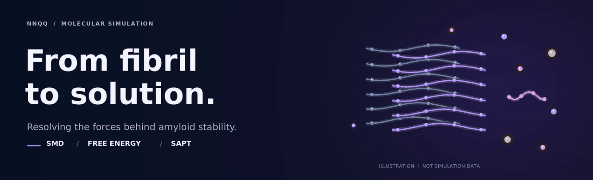

<p align="center">
  
</p>

<h1 align="center">Driving Forces of Amyloid Protofibril Stability</h1>

<p align="center">
  <strong>Connecting peptide extraction, free energy, and molecular interactions.</strong><br>
  All-atom molecular dynamics · Nonequilibrium free-energy analysis · Quantum chemistry
</p>

<p align="center">
  <a href="https://doi.org/10.26434/chemrxiv-2026-skt9d"></a>
  
  
  
</p>

<p align="center">
  <a href="#research-question">Research question</a> ·
  <a href="#computational-workflow">Workflow</a> ·
  <a href="#getting-started">Getting started</a> ·
  <a href="#citation">Citation</a>
</p>

<p align="center"><sub>The banner is an illustration, not a simulation trajectory. <a href="docs/assets/amyloid-static.png">View the static version.</a></sub></p>

---

## NNQQ1 — KCl simulation trajectory

https://github.com/user-attachments/assets/e6132a06-1c1f-40ce-8f0a-d88e164e54d9


## Research question

**What holds an amyloid protofibril together, and how do ions change the balance?**

This repository contains computational workflows, analysis scripts, and supporting data for **Driving Forces of Amyloid Protofibril Stability**. The study follows peptide extraction from an ordered NNQQ assembly into water and ionic solution, connecting free-energy estimates with the interactions between peptides, ions, and their environment.

NNQQ is a short amyloid-forming motif from the yeast prion protein Sup35. Its compact size makes it a useful model for examining how molecular packing and solution conditions contribute to amyloid stability.

| Model | Environments | Complementary methods |
| :--- | :--- | :--- |
| NNQQ amyloid assemblies | Water · NaCl · KCl | All-atom SMD · Jarzynski analysis · SAPT |

**Read the preprint:** [10.26434/chemrxiv-2026-skt9d](https://doi.org/10.26434/chemrxiv-2026-skt9d)

## Computational workflow

| Stage | Approach | What it examines |
| :--- | :--- | :--- |
| **01 · Molecular models** | Construct NNQQ assemblies in the selected solvent environment | Peptide packing and the surrounding molecular environment |
| **02 · Peptide extraction** | Perform all-atom steered molecular dynamics | Force and displacement during peptide detachment |
| **03 · Free-energy analysis** | Apply the Jarzynski estimator to nonequilibrium work profiles | The free-energy profile along the chosen extraction coordinate |
| **04 · Interaction analysis** | Apply symmetry-adapted perturbation theory to selected configurations | Electrostatic, exchange, induction, and dispersion contributions |

<p align="center">
  
</p>

<p align="center"><em>Computational workflow linking molecular models, peptide extraction, and interaction-energy analysis.</em></p>

<details>
<summary><strong>How the free-energy and quantum analyses complement each other</strong></summary>

The molecular dynamics analysis follows peptide extraction in an explicit molecular environment. Its free-energy profile depends on the selected extraction site, reaction coordinate, sampling, and reference state.

SAPT resolves the interaction energy of selected molecular pairs into electrostatic, exchange, induction, and dispersion contributions. These components provide a molecular interpretation of the configurations examined; a pair interaction energy is a different quantity from the free energy of peptide extraction in solution.

</details>

## Getting started

### Software used

| Software | Version | Role |
| :--- | :--- | :--- |
| **GROMACS** | **2022.2** | Molecular dynamics simulations |
| **Python** | **3.11.8** | Analysis and visualization |

Quantum-chemistry software, basis sets, and calculation settings should be taken from the manuscript and the relevant calculation inputs. Python package requirements depend on the analysis script being run.

### Get a local copy

```bash
git clone https://github.com/najla23/Amyloid-Fibril-to-Ionic-microenvironments.git
cd Amyloid-Fibril-to-Ionic-microenvironments
```

Check your software versions:

```bash
gmx --version
python --version
```

Start with the preprint and its methods, then select the simulation inputs or analysis scripts for the workflow of interest. Check input paths, units, and settings before running a calculation.

<details>
<summary><strong>Details to retain when reproducing or extending the analysis</strong></summary>

- **Molecular model:** polymorph, peptide selection, terminal protonation, force field, and ion parameters.
- **Extraction protocol:** pulling direction, spring constant, pulling rate, and trajectory selection.
- **Free-energy analysis:** temperature, coordinate interval, work definition, reference state, and uncertainty procedure.
- **Quantum calculations:** molecular geometries, charge states, SAPT level, and basis sets.
- **Visualization:** distinguish any display smoothing from the data used for numerical integration and free-energy estimation.

These details make comparisons between environments and methods easier to interpret.

</details>

## Citation

If you use these workflows or build on this study, please cite:

**A. Najla Hosseini.** *Driving Forces of Amyloid Protofibril Stability.* ChemRxiv (2026).<br>
[https://doi.org/10.26434/chemrxiv-2026-skt9d](https://doi.org/10.26434/chemrxiv-2026-skt9d)

<details>
<summary><strong>Copy BibTeX</strong></summary>

```bibtex
@misc{hosseini2026amyloid,
  author    = {Hosseini, A. Najla},
  title     = {Driving Forces of Amyloid Protofibril Stability},
  year      = {2026},
  publisher = {ChemRxiv},
  note      = {Preprint},
  doi       = {10.26434/chemrxiv-2026-skt9d},
  url       = {https://doi.org/10.26434/chemrxiv-2026-skt9d}
}
```

</details>

## Acknowledgements

This work was supported by **Sven och Lilly Lawskis Fond för Naturvetenskaplig Forskning**, grant **N2025-0023**.

## Questions and discussion

For questions about the workflows, reproducibility, or a possible issue, please [open an issue](https://github.com/najla23/Amyloid-Fibril-to-Ionic-microenvironments/issues). Include the script name, software versions, command used, and relevant error output where applicable.

---

<p align="center">
  <a href="https://doi.org/10.26434/chemrxiv-2026-skt9d">Read the study</a> ·
  <a href="https://github.com/najla23/Amyloid-Fibril-to-Ionic-microenvironments/issues">Ask a question</a>
</p>

<details>
<summary>Repository visits</summary>

[](https://hits.sh/github.com/najla23/Amyloid-Fibril-to-Ionic-microenvironments/)

</details>
